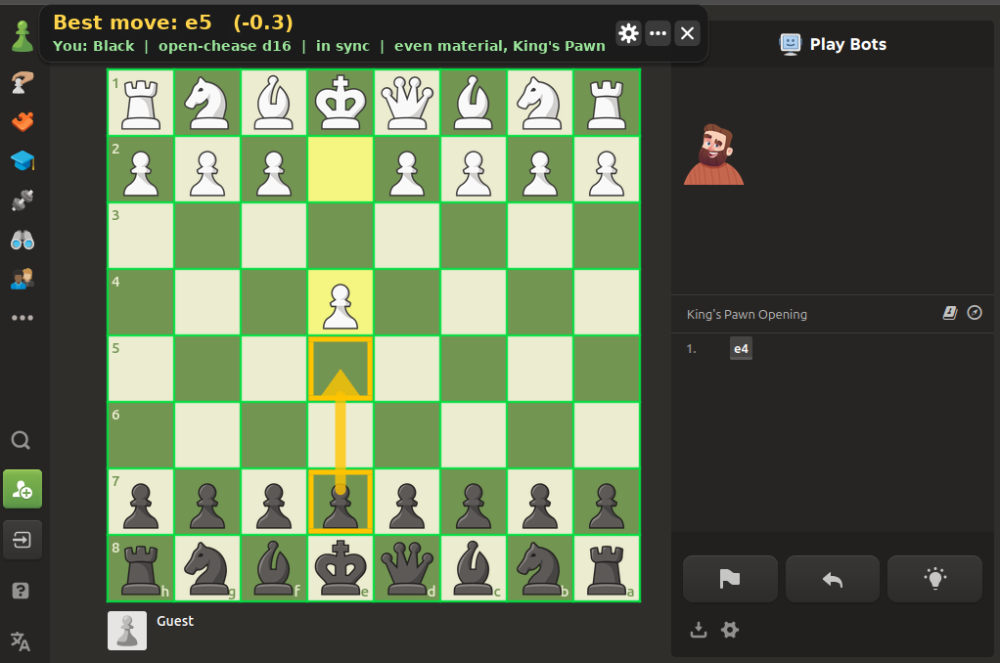

<h1 align="center">♟️ open-chease [beta] ♟️</h1>

<p align="center">
<b>A chess overlay for Linux, Windows and Mac that finds the board on your screen and shows you the best move.</b>
</p>

<p align="center">
  <a href="https://sevvy-wevvy.com/discord">
    
  </a>
  <a href="https://sevvy-wevvy.com/donate" target="_blank" style="margin-left:10px;">
    
  </a>
</p>

<p align="center">
  open-chease watches your screen for a chess board, outlines every square in green and draws an arrow on the best move for your team.<br>
  It updates twice a second and works on Linux (Hyprland, GNOME, XFCE, sway and most other X11 desktops), Windows 10/11 and macOS 14+.<br>
  I mainly made this to mess with my friends, so please dont use it in rated games. chess.com and lichess will ban you for it.<br> <br>
  Do you like this project? If so, please let me know!
  <a href="https://sevvy-wevvy.com/discord">Discord</a>
</p>

<p align="center">
This is the <b>beta</b> branch, new stuff thats mostly working gets tested here before it goes to main. The commands below install this branch, the stable one is on <a href="https://github.com/sevvy-wevvy/open-chease">main</a>.
</p>

<p align="center">
  <br>
  <sub>me vs the Pepe bot on chess.com</sub>
</p>

<details>
<summary align="center"><b>⬇️ Install ⬇️</b></summary>

<br>

<p align="center">
Find your computer below and paste its one command into a terminal. It downloads everything once, so running it again just starts it, and your settings stick around after a reboot.
</p>

<br>

---

<h2 align="center">🐧 Linux</h2>

<p align="center">
Open a terminal and paste this, works the same in bash, zsh and fish:
</p>

```sh
curl -fsSL https://raw.githubusercontent.com/sevvy-wevvy/open-chease/beta/get.sh | bash
```

<p align="center">
No curl? wget works too:
</p>

```sh
wget -qO- https://raw.githubusercontent.com/sevvy-wevvy/open-chease/beta/get.sh | bash
```

<p align="center">
Everything goes in <code>~/.local/share/open-chease</code>
</p>

<br>

---

<h2 align="center">🪟 Windows</h2>

<p align="center">
Open <b>PowerShell</b> (start menu, type powershell, NOT cmd) and paste this:
</p>

```powershell
irm https://raw.githubusercontent.com/sevvy-wevvy/open-chease/beta/get.ps1 | iex
```

<p align="center">
Its not signed, so SmartScreen might say "Windows protected your PC" the first time. Click More info > Run anyway.
</p>

<p align="center">
Some engines in the library need the <a href="https://aka.ms/vs/17/release/vc_redist.x64.exe">Visual C++ runtime</a>, it says so next to them.
</p>

<p align="center">
Everything goes in <code>%LOCALAPPDATA%\open-chease</code>
</p>

<br>

---

<h2 align="center">🍎 Mac</h2>

<p align="center">
Open <b>Terminal</b> (Cmd + Space, type terminal, hit enter) and paste this:
</p>

```sh
curl -fsSL https://raw.githubusercontent.com/sevvy-wevvy/open-chease/beta/get.sh | bash
```

<p align="center">
It builds itself on your mac the first time, so you need apples command line tools. If you dont have them run <code>xcode-select --install</code> first.
</p>

<p align="center">
macOS will ask you to let Terminal record the screen. Turn it on in System Settings > Privacy & Security > Screen Recording, then paste the command again.
</p>

<p align="center">
Everything goes in <code>~/Library/Application Support/open-chease</code>
</p>

<br>

---

<h2 align="center">⚙️ Options</h2>

<p align="center">
The first run also grabs Stockfish (about 80 MB) so the moves are way stronger. Add <code>--no-stockfish</code> if you dont want it, or <code>--update</code> to get the newest open-chease.
</p>

<p align="center"><b>Linux and mac</b></p>

```sh
curl -fsSL https://raw.githubusercontent.com/sevvy-wevvy/open-chease/beta/get.sh | bash -s -- --update
```

<p align="center"><b>Windows</b></p>

```powershell
& ([scriptblock]::Create((irm https://raw.githubusercontent.com/sevvy-wevvy/open-chease/beta/get.ps1))) --update
```

<br>

</details>

<details>
<summary align="center"><b>📦 Run From A Clone 📦</b></summary>

<p align="center">
If you clone it, it just uses the prebuilt binary in <code>bin/</code> and doesnt download open-chease again.
</p>

```sh
git clone -b beta https://github.com/sevvy-wevvy/open-chease
cd open-chease
./run.sh
```

<p align="center">
On Windows double click <code>run.bat</code> (or run <code>run.ps1</code> from PowerShell).
</p>

<p align="center">
If the prebuilt one doesnt run on your distro (glibc older than 2.34) run.sh rebuilds it for you. All it needs is gcc, every header is already in the repo. Macs always build it on the first run. The Windows exe in <code>bin/</code> gets cross compiled with <code>./build.sh win</code> (needs mingw-w64).
</p>
</details>

<details>
<summary align="center"><b>⌨ How To Use ⌨</b></summary>

<p align="center">
Open a game on lichess, chess.com or pretty much anywhere with a flat colored board and it should find it within a second.<br> <br>
<b>White / Black</b> - Pick your team when it asks<br>
<b>X on the popup</b> - Its not a board, ignore it (stays ignored while its on screen)<br>
<b>Gold arrow</b> - Your best move, shows on your turn<br>
<b>Top box</b> - The move written out plus the score (+0.4 means youre a little ahead)<br>
<b>X on the top box</b> - Stop following that board<br>
<b>Gear on the top box</b> - Settings, they save so they stick next time (theres a whole section on them below)<br>
<b>... on the top box</b> - Opens the menu:<br>
&nbsp;&nbsp;<b>Helper mode</b> - Click it to go Helper, again for Both, again for back to cheats (more below)<br>
&nbsp;&nbsp;<b>Show what it sees</b> - Puts a little tag on every square with the piece it thinks is there (white tag = white piece, black tag = black piece)<br>
&nbsp;&nbsp;<b>Fix pieces</b> - Click a square, then pick what's really there (or Empty, or whose turn it is). Your fixes stick until that piece moves. Click Done fixing in the menu when youre done, the board isnt clickable for the game while this is on<br>
&nbsp;&nbsp;<b>Its black's/white's turn</b> - If it got whose turn it is wrong<br>
&nbsp;&nbsp;<b>Engines</b> - Opens the engine library<br>
&nbsp;&nbsp;<b>Rescan board</b> - Reads the whole board again if it got lost (moves went by too fast or something)<br>
&nbsp;&nbsp;<b>Switch team</b> - If you picked the wrong team<br>
&nbsp;&nbsp;<b>Restart</b> - Starts it fresh<br>
&nbsp;&nbsp;<b>Update</b> - Grabs the newest version and restarts<br>
&nbsp;&nbsp;<b>Quit</b> - Asks first, then closes it<br>
<b>Ctrl + C</b> - Quit (in the terminal you started it from)
</p>
</details>

<details>
<summary align="center"><b>🤝 Helper Mode 🤝</b></summary>

<p align="center">
Dont want it playing for you? Hit <b>Helper mode</b> in the ... menu (or Gear > Fun > Mode). It stops showing moves completely and just tells you stuff about the game instead. Clicking it again goes to <b>Both</b>, which keeps the moves and adds all the helper stuff on top, and once more goes back to plain cheats.<br> <br>
The box always has whose turn it is, your win % (and how much the last move changed it, like +6) and a warning when someone's in check.<br> <br>
<b>Danger alerts</b> - "your queen is in danger" when something of yours can get taken for cheap, and "they have mate in 3" when its coming. Set it to With arrow and it also draws an arrow from the piece thats attacking it<br>
<b>Threats</b> - what they'd play if they got another move right now, like "Nc2+ would fork your king and rook". With arrow draws it on the board too<br>
Both arrows are red and dashed by default, Threat arrow, Threat color and Threat size in Gear > Helper change that<br>
<b>Hint button</b> - the ? next to the gear. First click shows which piece, second where it goes, third the whole move<br>
<b>What a ___ plays</b> - pick 1400 to 2400 and it tells you what someone that rated would probably play. Its your engine turned down, so dont take it as gospel<br>
With a second opinion engine picked in Gear > Engine it also tells you when the two engines dont agree. Usually means its a tricky spot<br> <br>
Then theres a bunch of smaller stuff: material (up 2, down 3), what got taken, the last few moves, your W/L since you started it, a turn timer, and the opening name. It knows about 70 openings (yes the Bongcloud is in there) and says middlegame or endgame once youre out of book.<br>
The win graph is a little line under the box, green when youre winning. When the game ends you get a game report with an accuracy % for both of you, same formula lichess uses.<br>
Last move outlines the last move in yellow. Hanging pieces marks pieces that are attacked and not defended, yours, theirs or both, and you pick the color and the look (corners, brackets, dashed...). Off by default since its kinda a hint. Rate my moves still works too, so blunders still get a ?? and a roast.<br> <br>
All of it is under Gear > Helper and you can turn each one off. The win graph, check ring, last move and hanging pieces show in normal mode too, and material and the opening go in the status line there.
</p>
</details>

<details>
<summary align="center"><b>🎛 Settings 🎛</b></summary>

<p align="center">
Settings are split into tabs: Look, Yours, Theirs, Engine, Fun, Helper, Vision and Themes. Every tab has a <b>Reset this tab</b> button if you mess something up. Not sure what something does? Leave the mouse on it for a sec and a little tip pops up<br> <br>
<b>Look</b><br>
14 themes, where the box sits (top, bottom, or stacked on the left or right), box size and how see-through it is<br>
The grid can be lines, just the outline, corners or off, in any color<br>
Score as pawns (+0.4), centipawns (+40) or win %, plus an eval bar next to the board if you want one<br> <br>
<b>Yours</b> (your move)<br>
Arrows can be straight, bent for knights, curved, a swoosh, dashed, dotted, glowing or double<br>
The piece to move and where it goes each get their own marker, theres 13 to pick from<br>
You can show just the piece, just the square, or wait a few seconds before it shows anything so you get to think first<br>
Top moves shows the 2nd and 3rd best too, as thinner faded arrows with a number on them<br>
Rainbow is one of the colors too<br> <br>
<b>Theirs</b> (their move)<br>
Same options as yours, shown as text, on the board or both<br> <br>
<b>Engine</b><br>
<b>Engine</b> picks which one it uses and remembers it. <b>Get engines</b> opens the library with 44 engines (Reckless, Pawnocchio and a bunch more besides Stockfish) and how strong and how big each one is. You can type to search in it, Esc closes it<br>
Think time, updates a second, threads, memory, and whether it keeps thinking on their turn<br>
<b>Second opinion</b> runs another engine next to the main one. In cheats mode it says "Koivisto says Nf3" with a cyan dotted arrow when it picks something else, or that it agrees. You can also turn it on from the Installed tab in the engine library with the 2nd button<br>
If an engine has faster builds for newer cpus (avx2, avx512...) it downloads the best one yours can run<br>
<b>Lc0</b> shows up in the library if you have an nvidia card and lc0 installed. Theres no official linux download so you need it from the AUR or built yourself, then Get grabs a net and points it at your gpu<br>
The list lives in <code>engines.txt</code> here so new ones show up without updating. Engines that come in a zip or tar keep their whole folder, so ones that need a network file next to them (like Arasan) work too. Any UCI engine you drop in the <code>engines</code> folder (Open folder in the library takes you there) shows up too<br> <br>
<b>Fun</b><br>
Mode is Cheats, Helper or Both (see Helper Mode above)<br>
The move picker can give you the best move, one thats close enough, a random top 3, a coin flip, a totally random move, the worst move or only blunders. Theres also 5 human ones from 800 to 2400. They pick like a person that rated would (recaptures first, checks, early queen moves when its low rated) and the higher ones lean on the real engine move a lot more. In my tests 800 loses about a pawn a move on average and 2400 about a fifth of one<br>
A strength cap (Full down to 1400), trash talk, grades for your moves and theirs with a roast attached, and confetti when you win<br> <br>
<b>Helper</b><br>
Material, taken pieces, opening & phase, win graph, turn timer, game report, last move, check warning, hanging pieces, move list, danger alerts, session score, threats, the hint button and what a ___ plays. Each one is its own setting<br>
Danger alerts and threats can be off, just text or text with an arrow, and the arrow gets its own style, color and size<br> <br>
<b>Vision</b><br>
"Show what it sees" on from the start, square names on every square, and Rescan board (same as the one in the ... menu)<br>
If your piece set keeps getting misread (rooks as knights, that kind of thing) you can teach it your pieces, the steps are in the Vision tab too:<br>
1. open a game so the board is on screen<br>
2. hit ... > Fix pieces, click a wrong square and pick whats really there<br>
3. do that for every wrong one, then hit Done fixing<br>
4. come back to Gear > Vision and hit <b>Teach these pieces</b>. It learns the shapes from the board as it is right now and remembers them for that board<br>
<b>Forget learned pieces</b> throws that away and goes back to the built in shapes<br> <br>
<b>Themes</b><br>
Every theme as a little preview card, click one to use it. Under that you can make up to 3 of your own: pick a slot and a part (box, text, buttons, grid, menus...), then click a color. It changes live. <b>Copy current theme</b> starts you off from whatever theme youre on. Your themes save with the rest of the settings
</p>
</details>

<details>
<summary align="center"><b>⚙️ Options ⚙️</b></summary>

<p align="center">
These work with run.sh and get.sh, and with run.ps1 / the scriptblock way on windows.<br> <br>
<b>--team white</b> or <b>--team black</b> - Skips the question and always plays that side<br>
<b>--builtin</b> - Uses my engine even if Stockfish is there<br>
<b>--engine PATH</b> - Use any other UCI engine<br>
<b>--backend wayland / gnome / x11</b> - Force how it grabs the screen if it picks wrong (linux only, windows and mac only have one way)<br>
<b>-v</b> or <b>-vv</b> - Prints what its seeing
</p>
</details>

<details>
<summary align="center"><b>📝 Good To Know 📝</b></summary>

<p align="center">
Start it before the game starts if you can. It learns your piece set from the starting position and in my tests it got 99.9% of moves right that way. It remembers the set for each board look, so once its seen a game start on a site it uses the right pieces there even when you jump in mid game later. Jumping in mid game works too but it has to guess the pieces from shapes it already knows, so with a weird piece set its more like 80%. If it gets something wrong use Fix pieces.<br> <br>
Flat board themes work best (lichess brown/blue/green, chess.com green, most others). Wood and marble boards work too but worse, it finds almost all of them and reads every piece right on about 7 out of 10. Recolored piece sets (pink, gold) are hit or miss, mostly when the pieces are close to the square color.<br> <br>
If part of the board is covered or scrolled off screen it keeps following the moves it can see, but it wont re-read the whole board until you can see all of it again. Same with the settings or ... menu, if they sit on the board it pauses and catches up when you close them.<br> <br>
GNOME shows the screen sharing icon while its running, thats normal. On XFCE the compositor has to be on (its on by default, it'll tell you if it isnt).
</p>
</details>

<details>
<summary align="center"><b>🩹 If Something Breaks 🩹</b></summary>

<p align="center">
<b>It never finds the board</b> - Make sure the whole board is on screen and its a flat theme. Run it with <code>-v</code>, it prints how close it got ("best N/64")<br>
<b>Every square says ?</b> - Try Rescan board in the ... menu. If it keeps happening send me the <code>-v</code> output<br>
<b>Wrong piece somewhere</b> - ... > Fix pieces, click the square and pick the right one. It sticks until that piece moves<br>
<b>Lots of pieces wrong after jumping in mid game</b> - It hasnt seen that piece set start a game yet. Best fix is starting it before the game so it learns the set, it remembers it for that board after. Or fix the wrong ones with Fix pieces and hit Gear > Vision > Teach these pieces<br>
<b>Thinks its the wrong turn</b> - ... > Its black's/white's turn<br>
<b>It lost track after a fast few moves</b> - ... > Rescan board. It hides its own arrows for a second so they dont get in the way of the read<br>
<b>The engine died</b> - It restarts by itself. If one keeps dying pick another in Gear > Engine<br>
<b>Two monitors</b> - Works, it watches all of them, and plugging one in or out while its running is fine too (Hyprland, sway and GNOME)<br>
<b>Nothing shows up on Hyprland/sway</b> - Run with <code>-v</code> and check it says what screen formats it got. If it says it cant read them please open an issue with that line<br> <br>
Still broken? Open an <a href="https://github.com/sevvy-wevvy/open-chease/issues">issue</a> or yell at me on <a href="https://sevvy-wevvy.com/discord">Discord</a>, the <code>-v</code> output helps a ton.
</p>
</details>

<details>
<summary align="center"><b>🧠 How It Works 🧠</b></summary>

<p align="center">
<b>Grabbing the screen</b> - wlr-screencopy on Hyprland/sway, Mutters ScreenCast on GNOME, XGetImage on X11 stuff like XFCE, plain GDI BitBlt on Windows and ScreenCaptureKit on macOS<br>
<b>The overlay</b> - a click through layer-shell surface on Hyprland and sway, and a click through override-redirect window on GNOME and X11 since those dont have layer-shell. It only sends the parts of the screen that changed. On Windows its a layered window per monitor and on mac a borderless NSWindow, both of those let clicks through except when the mouse is over one of the buttons<br>
<b>Finding boards</b> - looks for rows of alternating square colors, tries every 8x8 grid that fits, then snaps it to the real square edges. If that finds nothing it tries again on a blurred copy looking for square edges instead of exact colors (thats how wood and marble boards get found). If the screen didnt change since the last look it skips it, and after 30 seconds with no board it only looks once a second<br>
<b>Following the game</b> - checks which squares have a white piece, a black piece or nothing, and matches that against every legal move (and pairs of moves) to figure out what was played. Promoted pieces get compared to the pieces already on the board<br>
<b>The engine</b> - its my own, in src/engine.c, does about 2 million positions a second. bin/open-chease-engine is the same thing as a normal UCI engine if you want to use it somewhere else. If Stockfish is around it uses that instead
</p>
</details>

<details>
<summary align="center"><b>🔨 Building & Tests 🔨</b></summary>

<p align="center">
<code>./build.sh</code> builds bin/open-chease and bin/open-chease-engine<br>
<code>tests/perft.sh</code> checks the move generator against known numbers<br>
<code>tests/fetch_pieces.sh cburnett merida alpha staunty maestro</code> grabs piece sets for the vision test<br>
<code>python3 tests/run_vision.py 1 60</code> runs 60 random boards through the vision code. Add <code>TEXTURES=wood,marble,gradient,noise</code>, <code>THEMES=purple,night,wood,red</code> or <code>TINTS="wFFB0B0,b3050C0"</code> to throw custom looking boards and recolored pieces at it<br>
<code>python3 tests/track_sim.py --games 60</code> plays 60 whole fake games through the tracker with all the annoying stuff sites do (dragging, move dots, promotion popups, check glow, missed moves) and tells you how many moves it got right. Needs <code>pip install chess</code><br> <br>
tests/page/index.html is a board that plays a game by itself (add <code>?flip=1</code>, <code>?fen=...</code> or <code>?ms=2500</code>). Its really handy for watching the overlay. Serve it with <code>python3 -m http.server</code> from tests/page.
</p>
</details>

<details>
<summary align="center"><b>🛠 Pull Requests 🛠</b></summary>

<p align="center">
Want to help with this? <a href="https://github.com/sevvy-wevvy/open-chease/pulls">Make A pull request!</a><br>
Pull request allow for anyone to request a change to this code. In turn meaning that <b>YOU</b> can contribute to this project.<br>
Boards it cant find or pieces it reads wrong are the most useful ones to fix. Keep it small, one thing per PR, and send it to the <b>dev</b> branch.<br>
Read <a href="CONTRIBUTING.md">CONTRIBUTING.md</a> first, it says how to test and whats ok (AI help is fine, as long as you know what it does and tested it).<br> <br>
As long as it works, and doesnt vary off too far from the main idea its very likely it get accepted!
</p>
</details>

<details>
<summary align="center"><b>💖 Credits 💖</b></summary>

<p align="center">
The built in piece shapes come from the lichess piece sets (cburnett, merida, leipzig, tatiana, companion, chessnut, kosal, cardinal, governor, fresca and riohacha), squished down to tiny 24x24 outlines.<br>
The overlay font is DejaVu Sans Bold.<br>
The Wayland and X11 headers in third_party/ are MIT licensed.
</p>
</details>

<details>
<summary align="center"><b>⚖️ License ⚖️</b></summary>

<p align="center">
  <small>
    <b>open-chease</b> is released under the
    <a href="https://www.gnu.org/licenses/gpl-3.0.html" target="_blank">GPL-3.0 License</a>.
    This means you're free to use, modify, and share the code. As long as you:
  </small>
</p>

<p align="center">
  <small>
    • Keep your changes <b>open-source</b> under the same license. <br>
    • <b>Give proper credit</b> to the project and original contributors. <br>
    • Include a copy of the <a href="https://www.gnu.org/licenses/gpl-3.0.html">GPL-3.0 license</a> with your distribution.
  </small>
</p>

<p align="center">
  <small>
    In short: play fair, keep it open, and give credit where it's due.
  </small>
</p>
</details>

<details>
<summary align="center"><b>🩷 Donate 🩷</b></summary>

<p align="center">
I accept donations over few platforms, below are where you can help support my projects and more.<br>
<b>Ko-fi</b> (Preferred) - https://sevvy-wevvy.com/kofi<br>
<b>Patreon</b> - https://sevvy-wevvy.com/patreon<br>
<b>Throne</b> - https://sevvy-wevvy.com/throne
</p>
</details>
